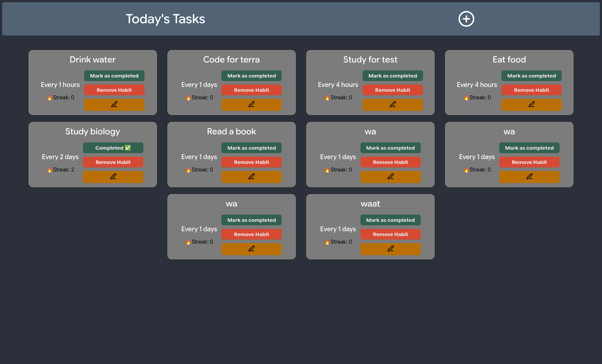

# Habby
Habby is a habit tracker written as a Vue + TypeScript single-page application for the Hack Club terra program.

The cards currently get saved locally in your browser's localStorage, and you can add and remove them on demand.

It allows you to create habits with inputs for name, interval and the type of interval (either minutes, hours or days) 
with a responsive UI that works nicely on all kinds of devices.

How it looks:

# Features:
- A responsive UI that works on pretty much all (modern) devices
- Streaks: if you don't do a habit for longer than your repetition time, your streak will reset, otherwise it will
- Modal, for warning when deleting a habit and when editing a habit.

# How to use:

Quick use: visit **https://goldmonke.me/Habby/** which is hosted with github pages

To host it yourself:

Prerequisites:
`pnpm`

Then clone the repo to your device of choice, cd into the `client` folder and run `pnpm install`, and wait for it to install all dependencies. Then you can either run pnpm run dev to use it quickly, however to use it long term you should run `pnpm run build`.

Then host the files in the `dist` subfolder on your provider of choice (or your local device).

# Dependencies
This project has the following dependencies:
- **vue** as the main framework
- **vueuse** for outsideclick for the modal
- **lucide** for icons

# Credits:
- [This guide](https://medium.com/@romanvinnick/vue3-composition-api-creating-a-reusable-modal-component-with-outside-click-handling-43e830d289c1) for helping me with the modals